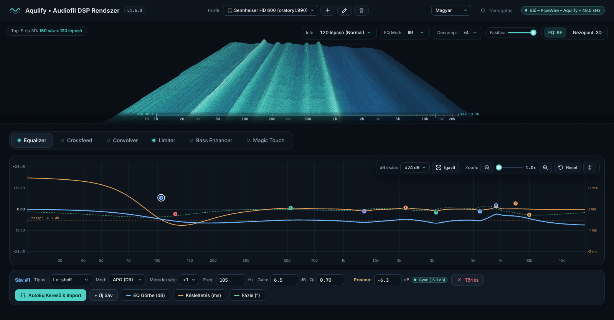

# Aqulify • Audiofil DSP rendszer Linuxra és Windowsra

[](https://github.com/Szorgos/ee-phase-waterfall-analyzer/releases/latest)
[-0078D6?style=flat-square&logo=windows)](https://github.com/Szorgos/ee-phase-waterfall-analyzer/releases/latest/download/Aqulify-Setup.exe)
[](https://github.com/Szorgos/ee-phase-waterfall-analyzer#telep%C3%ADt%C3%A9s-linuxon-egyetlen-parancsb%C3%B3l)
[](https://github.com/Szorgos/ee-phase-waterfall-analyzer#-macos-verzi%C3%B3)
[](#-támogatás)
[](https://www.gnu.org/licenses/gpl-3.0)

> ### 📦 **Gyors Letöltés Windows 11-re:**
> 👉 **[Aqulify-Setup.exe letöltése – mindig a legújabb kiadás](https://github.com/Szorgos/ee-phase-waterfall-analyzer/releases/latest/download/Aqulify-Setup.exe)**  
> *(Telepítő: Aqulify motor tálcaikonnal, saját ablakos felület és az Equalizer APO plugin automatikus bekötése. Korábbi verziók és ellenőrzőösszegek: [Kiadások](https://github.com/Szorgos/ee-phase-waterfall-analyzer/releases).)*

---

Az **Aqulify** valós idejű hangfeldolgozó lánc zenehallgatáshoz: parametrikus EQ több mint 8 850 AutoEq fejhallgató-profillal, crossfeed, konvolver (szobakorrekció), bass enhancer és True Peak limiter az EasyEffects DSP könyvtáraival, valamint a **Magic Touch**, egy automatikus, visszafogott hangszépítő és helyreállító. A lejátszott jel valódi spektruma élő 3D vízesésen látszik, az EQ fázis- és csoportkésleltetés-görbéjével együtt. Linuxon PipeWire virtuális kimenetként, Windows 11-en Equalizer APO pluginként működik; a felület magyarul és angolul használható. Ingyenes és nyílt forrású (GPL-3.0).



---

### ✨ Filozófia

> *„A tökéletes transzparencia az, amikor a technika láthatatlanná válik, és csak a zene marad a térben.”*

> ℹ️ **Névváltás:** a program 1.4.8-ig **AetherAudio** néven futott. Mivel ezt a nevet más hangszoftverek is használják, **Aqulify** lett az új neve. A korábbi telepítés frissítéskor automatikusan átáll: a beállítások, az EQ profilok és a konvolver IR megmaradnak.

Az **Aqulify** ezt egyesíti a modern digitális jelfeldolgozással:
* **DSP:** az EasyEffects DSP könyvtárai (LSP, Calf, libbs2b, SpeexDSP, zita-convolver); IIR, FIR, FFT és SPM EQ mód.
* **Megjelenítés:** a 3D vízesés a lejátszott jel valódi spektrumát mutatja (a motor számolja); az EQ-görbe, a fázis és a csoportkésleltetés ugyanazokkal a szűrőkkel készül, amelyek a hangot feldolgozzák.

---

## 🎧 Főbb Képességek és Funkciók

1. **Élő 3D Akusztikai Vízesés & Spektrogram (Hardveres GPU gyorsítás / OpenGL / Direct3D):**
   * A motor valódi FFT spektruma (160 sáv, 0 Hz – 24 kHz: 10 Hz fölött közel logaritmikus, alatta lineáris tengelyen) 60 FPS gördüléssel. A mély sávok (75 Hz alatt) külön, kb. 3 Hz felbontású elemzésből jönnek, így a basszus nem kenődik szét a legalsó sávokig.
   * **GPU-gyorsítás a zene védelmében:** A 3D felületet a videokártya rajzolja (Linuxon OpenGL/Mesa, Windowson Direct3D backenddel a WebGL alatt); a rács pontjait és színeit a JavaScript számolja, így a grafika **csak kis mértékben terheli a processzort**, és még a legösszetettebb nézeteknél sem akasztja meg a valós idejű zenelejátszást (zéró hangkimaradás).
   * **Fakítás és testreszabás:** Állítható hőtérkép-fakítás csúszka (élénk színektől a lágy szürkeárnyalatig); időlépcsők: 60 / 120 / 180; nézőpontok: 3D izometrikus, oldalsó profil, felülnézet (a sávot kitöltő spektrogram); folyásirány: lefelé (az új sorok hátul indulnak) vagy felfelé (elöl, a skálánál), váltáskor összeomló és újraépülő animációval; trapézkorrekció gombokkal (a hátsó él keskenyebb vagy szélesebb, mint a kivetítőnél).
   * **Frekvenciaskála (0 Hz – 24 kHz):** A vízesés első éle a skálán ül, a skála a háló két széléig ér, így a csúcsok azonnal leolvashatók. A skála két szélén kis diszkrét felirat mutatja az elmúlt 10 másodperc legmélyebb (legalább fél másodpercig jelen lévő) és legmagasabb frekvenciáját, a gyors türkiz határolójelek pedig valós időben követik a hangsáv tartományát.
   * **Előcsengés (pre-ringing) jelzése:** FIR / FFT / SPM (lineáris fázisú) módban egy diszkrét felirat jelzi, hogy előcsengés lehetséges. Mértéke általában olyan kicsi, hogy a vízesésen alig látszik; a program nem nagyítja fel.

2. **EQ-görbe, fázis és csoportkésleltetés ($-\frac{d\phi}{d\omega}$):**
   * A görbét a motor számolja az LSP szűrőkkel (sávtípus, szűrőmód, meredekség, decramp szerint). FIR / FFT / SPM módban a fázis lineáris, a késleltetés a feldolgozás késleltetése. Motor nélkül a felület közelítő görbét rajzol (RBJ biquad; harang-, polc-, alul- és felüláteresztő sávokra).
   * Pontok húzása a görbén, egérgörgővel Q-állítás, dupla kattintással új sáv; a kijelölt sáv típusa, szűrőmódja, meredeksége, frekvenciája, gainje, Q-ja és (sáváteresztő / létra típusnál) sávszélessége állítható.

3. **8 850+ Fejhallgató AutoEq Profil Kereső & Kézi Importálás:**
   * **Valós AutoEq Adatbázis Integráció:** A Jaakko Pasanen-féle hivatalos AutoEq tároló több mint 8 850 fül- és fejhallgatójának (oratory1990, Crinacle, Rtings stb.) élő keresése és profil-letöltése közvetlenül a GitHubról egyetlen kattintással.
   * **Kézi import (fájl vagy beillesztett szöveg):** paraméteres szűrőlisták `Filter N: ON PK Fc … Hz Gain … dB Q …` formában (AutoEq ParametricEQ, Equalizer APO, REW), PK / LS(C) / HS(C) / LP / HP / NO / AP / BP típusokkal (Q vagy BW Oct megadással) és `Preamp:` sorral. A kikapcsolt (OFF) és a nem támogatott sorokat kihagyja, és kiírja, hány sort és miért. Grafikus EQ-t (GraphicEQ) és CSV frekvenciamenetet nem alkalmaz.
   * **EQ profilok:** AutoEq importkor és kézi beállításkor automatikusan profil készül; az aktív profil neve a fejlécben látszik, és a korábbi profilok újraindítás után is választhatók (tárolás: Linuxon `~/.config/aqulify/presets.json`, Windowson `%APPDATA%\Aqulify\presets.json`). Az importált AutoEq profil érintetlen marad: kézi módosításkor „– módosított” nevű saját profil készül.
   * **Automatikus preamp (dupla levonás nélkül):** Induláskor 0 dB. Ha az EQ-görbe klippelne, a preamp magától a görbe csúcsához igazodik (és a limiter bekapcsol). Ha az importált profil tartalmaz preampot, pontosan azt használja; ha nem, az automatika állítja be. A preamp az EQ része: kikapcsolt EQ-nál (Bypass) nem hat, így a Bypass az eredeti, érintetlen jelet adja.

4. **Kézi Mesterkapcsolók Minden Modulhoz (Ki/Bekapcsolható lánc):**
   * **Parametrikus EQ (LSP Parametric Equalizer):** legfeljebb 32 sáv, 12 szűrőtípus, RLC / BWC / LRX / APO szűrőmód, x1–x4 meredekség; IIR, FIR, FFT és SPM mód, decramp.
   * **Crossfeed Szimulátor (libbs2b):** Bauer bs2b (700 Hz / 4,5 dB), Jan Meier (650 Hz / 9,5 dB) és közeltéri stúdió (600 Hz / 3,5 dB) profil, vagy egyedi vágási frekvencia (300–2000 Hz) és szint (1–15 dB).
   * **Convolver (zita-convolver):** IR (WAV/IRS) betöltés és előnézet, IR szélesség, autogain, dry / wet, bemeneti és kimeneti erősítés; az IR a lejátszás mintavételére konvertálódik (SpeexDSP). A feldolgozási késleltetés nem nő az IR hosszával; kettőhatvány blokkméretnél (pl. 256, 512, 1024) nincs többletkésleltetés, más blokkméretnél legfeljebb egy blokknyi (az IR saját késleltetése megmarad). Szobakorrekcióhoz mérésből tervezett korrekciós szűrőt tölts be (pl. REW), ne a szoba nyers impulzusválaszát.
   * **Limiter (LSP Limiter):** 12 mód, túlmintavételezés (True Peak is), dither, lookahead / attack / release, stereo link, gain boost, ALR, bemeneti és kimeneti erősítés; alapértelmezés: -1,0 dB küszöb, True Peak / 24 bit. Kikapcsolt limiternél csak a 0 dBFS feletti minták vágódnak le. A túlvezérlés ellen elsősorban a teljes EQ-görbéhez igazított előerősítés véd; a limiter biztonsági háló (negatív preampú profil importjakor vagy betöltésekor automatikusan bekapcsol), nem hallásvédelem.
   * **Bass Enhancer (Calf):** pszichoakusztikai hiányzó alaphang szintézis (amount, harmonics, scope, floor, blend, listen, bemeneti és kimeneti erősítés).

5. **Magic Touch – automatikus, visszafogott hangszépítő:**
   * Elemzi a lejátszott felvételt, és csak azt igazítja, ami hiányzik vagy zavaró. A kimenet hangossága megegyezik a bemenetével; rendben lévő felvételen a jel bitre érintetlen.
   * **Karakter:** Természetes, Meleg, Fényes, Tágas. **Tartalom:** Automatikus (felismeréssel), Zene, Beszéd, Archív felvétel.
   * **Helyreállítás:** 50/60 Hz-es zümmögés eltávolítása, kattanásjavítás, zajcsökkentés.
   * Intenzitás csúszka, hangerőre kiegyenlített A/B összehasonlítás, részletes diagnosztika.

6. **Motor és felület:**
   * Linuxon PipeWire virtuális kimenet („Aqulify”), Windowson Equalizer APO plugin. A hangszál zárak nélkül veszi át a beállításokat; a modulok be- és kikapcsolása, valamint az EQ-mód és a decramp váltása rövid le- és felúsztatással, kattanás nélkül történik (lineáris fázisú módra váltáskor a kimenet a módhoz tartozó késleltetés kitöltéséig, kb. 0,1 s-ig néma). A felület és a grafika külön folyamatban fut, nem tartja fel a lejátszást.
   * WebSocket híd a `127.0.0.1` címen (az első szabad port: 47810–47814, végső tartalékként 8080): a motor a spektrumot, az EQ-görbét, a limiter erősítéscsökkentését és a mentett állapotot küldi; a felület az összes modulbeállítást, az IR-t és az EQ profilokat (a protokoll leírása: [docs/remote-api.md](docs/remote-api.md)).
   * **Felület:** magyarul és angolul (alapból a rendszer nyelvén, váltás a fejlécben); Linuxon saját ablakban (WebKitGTK, ennek hiányában böngészőben), Windowson saját ablakban (WebView2).

---

## 🚀 Telepítés Linuxon (Egyetlen Parancsból)

### Fedora: COPR-tárolóból (ajánlott, automatikus frissítéssel)

```bash
sudo dnf copr enable nlali/aqulify
sudo dnf install aqulify
```

Fedora 43, 44, 45 és rawhide (x86_64 és aarch64). A tároló engedélyezése után az Aqulify a **Discoverben** és a **GNOME Szoftverben** is megjelenik, és a frissítései a rendszerfrissítésekkel együtt érkeznek. Projektoldal: [copr.fedorainfracloud.org/coprs/nlali/aqulify](https://copr.fedorainfracloud.org/coprs/nlali/aqulify/)

### Fedora: kész RPM csomag (tároló nélkül)
A [legújabb kiadásnál](https://github.com/Szorgos/ee-phase-waterfall-analyzer/releases/latest) töltsd le az `aqulify-<verzió>.fc<NN>.x86_64.rpm` fájlt, majd:

```bash
sudo dnf install ./aqulify-*.x86_64.rpm
```

A csomag a rendszerbe telepít (menü, ikon, Discover / GNOME Szoftver adatlap), a motor bejelentkezéskor magától indul (`systemctl --user status aqulify`). Eltávolítás: `sudo dnf remove aqulify`.

### Bármely disztribúció: telepítő szkript
A telepítő szkript automatikusan felismeri a disztribúciót, felrakja a szükséges csomagokat, lefordítja a C++ motort és regisztrálja az asztali alkalmazásikont (a saját mappádba, root jog nélkül).

### 1. Letöltés és Telepítés:
A [legújabb kiadásnál](https://github.com/Szorgos/ee-phase-waterfall-analyzer/releases/latest) töltsd le az `Aqulify-Linux-<verzió>.tar.gz` csomagot, majd:

```bash
tar xzf Aqulify-Linux-*.tar.gz
cd Aqulify-Linux-*/
./install.sh
```

Vagy a fejlesztői változat a GitHubról (frissítés: `git pull`, majd újra `./install.sh`):

```bash
git clone https://github.com/Szorgos/ee-phase-waterfall-analyzer.git
cd ee-phase-waterfall-analyzer
./install.sh
```

### 2. Támogatott Linux Disztribúciók:
* **Ubuntu / Debian / Linux Mint / Pop!_OS:** `apt-get` csomagkezelővel
* **Fedora / RHEL / CentOS:** `dnf` csomagkezelővel
* **Arch Linux / Manjaro / EndeavourOS:** `pacman` csomagkezelővel
* **openSUSE / SUSE:** `zypper` csomagkezelővel

---

## 🪟 Windows 11 verzió

Egyetlen telepítő: **`Aqulify-Setup.exe`**. Felismeri (vagy letölti) az **Equalizer APO**-t, a plugint automatikusan a lánc végére illeszti, parancsikonokat és eltávolítót hoz létre. A motor tálcaikonos háttéralkalmazásként fut, a GUI ugyanaz, mint Linuxon. Részletek: **[windows/README_WINDOWS.md](windows/README_WINDOWS.md)**.

### ⚠️ A telepítő nincs digitálisan aláírva – így indíthatod el

Az Aqulify ingyenes, egyszemélyes nyílt forrású projekt, ezért a Windows-telepítőnek egyelőre nincs kódaláíró tanúsítványa (a SignPath Foundation ingyenes programja csak már ismertebb projekteket fogad, egy fizetős tanúsítvány pedig évente 50–300 € körül van). A program ettől nem veszélyes: a teljes forráskód nyilvános, a telepítőt a GitHub Actions fordítja nyilvános naplóval, és minden kiadás mellett ott az ellenőrzőösszeg. A Windows viszont az aláíratlan, még kevesek által letöltött programokra figyelmeztet.

1. **Letöltéskor** a böngésző (Edge, Chrome) jelezheti, hogy a fájlt „ritkán töltik le”: *… → Megtartás* (Edge-ben: *Továbbiak megjelenítése → Megtartás mindenképp*).
2. **Ellenőrizd a fájlt (ajánlott):** PowerShellben `Get-FileHash .\Aqulify-Setup-<verzió>.exe` – az eredménynek egyeznie kell a kiadás `.sha256` fájljában lévő értékkel.
3. **Indításkor** a SmartScreen „A Windows megvédte a számítógépet” ablakot mutat: *További információ → Futtatás mindenképp*.
4. **Intelligens alkalmazásvezérlés (Smart App Control):** ha be van kapcsolva, az aláíratlan programokat (az Equalizer APO-ba töltött plugint is) kivétel nélkül letiltja, egyedi engedélyezésre nincs lehetőség. Ilyenkor csak a kikapcsolása segít: *Windows biztonság → Alkalmazás- és böngészővezérlés → Intelligens alkalmazásvezérlés beállításai → Ki*. A 2026 tavaszi Windows 11 frissítések óta ez később újra bekapcsolható, régebbi rendszeren a visszakapcsoláshoz a Windows újratelepítése kellett – ezt mérlegeld.
5. Ha a **Microsoft Defender** tévesen kártevőnek jelölné, kérlek jelezd egy GitHub-hibajegyben; a fájlt a Microsoftnak is be lehet küldeni felülvizsgálatra (microsoft.com/wdsi/filesubmission).

Ha a Windows-figyelmeztetéseket nem szeretnéd megkerülni, a **Linux-verzió** forrásból fordul (`./install.sh`), ott ilyen korlát nincs.

A Linuxos és a Windowsos ág ugyanazt a C++ DSP láncot futtatja (`include/aether_chain.hpp`): LSP equalizer (IIR / FIR / FFT / SPM), Calf Bass Enhancer, libbs2b crossfeed, zita-convolver és LSP limiter. Az IR előkészítése és a konvolver indítása háttérszálon fut; az új konvolverre keresztúsztatással vált.

---

## 🍎 macOS verzió

Letöltés (az 1.7.1 kiadástól): **[Aqulify-macOS.dmg – mindig a legújabb kiadás](https://github.com/Szorgos/ee-phase-waterfall-analyzer/releases/latest/download/Aqulify-macOS.dmg)** (egy alkalmazás Apple Silicon és Intel Macre, macOS 12 vagy újabb). Nyisd meg, és húzd az **Aqulify**-t az *Alkalmazások* mappába.

Az Aqulify itt egyetlen alkalmazás: a motor a menüsorban fut (hullámforma ikon), az ablakban a megszokott felület látszik. Az ablak bezárása után a hangfeldolgozás folytatódik; a felület a menüsor-ikonból nyitható újra, és ott kapcsolható be az *Indítás bejelentkezéskor* is (macOS 13-tól).

* **macOS 14.2 vagy újabb:** a rendszerhangot a Core Audio adja át, illesztőprogram nélkül. Első indításkor a macOS engedélyt kér a rendszerhang rögzítésére: ezt engedélyezd. Amíg az Aqulify feldolgozza, az eredeti (feldolgozatlan) hang néma; kilépéskor visszaáll.
* **Régebbi macOS (12 – 14.1), vagy ha nem adsz engedélyt:** telepítsd az ingyenes [BlackHole 2ch](https://existential.audio/blackhole/) virtuális hangeszközt. Az Aqulify magától felismeri, a rendszer kimenetét a BlackHole-ra állítja, a feldolgozott hangot pedig a valódi eszközre küldi; kilépéskor az eredeti kimenet visszaáll.
* **Kimenet:** alapból a rendszer alapértelmezett kimenete (követi, ha a Hangbeállításokban másikat választasz); a felület fejlécében adott eszköz is választható.
* Beállítások: `~/Library/Application Support/Aqulify`, napló: `~/Library/Logs/Aqulify/aqulify.log` (a menüsor-ikonból is megnyitható).
* **Eltávolítás:** lépj ki az Aqulify-ból (menüsor-ikon → Kilépés), majd húzd az alkalmazást az *Alkalmazások* mappából a Kukába. Illesztőprogramot, rendszerbővítményt vagy háttérszolgáltatást nem telepít; a hangkimenet kilépéskor visszaáll, a bekapcsolt *Indítás bejelentkezéskor* az alkalmazással együtt megszűnik. A beállítások, a napló és a felület gyorsítótára a saját mappádban marad; ezeket így törölheted:
  ```
  rm -rf ~/Library/Application\ Support/Aqulify ~/Library/Logs/Aqulify ~/Library/WebKit/io.github.szorgos.Aqulify ~/Library/Caches/io.github.szorgos.Aqulify ~/Library/Preferences/io.github.szorgos.Aqulify.plist
  ```
  A rendszerhang-rögzítési engedély bejegyzése (*Rendszerbeállítások → Adatvédelem és biztonság*) ott kikapcsolható. A BlackHole-t (ha telepítetted) a saját eltávolítója távolítja el.

### ⚠️ Az alkalmazás nincs az Apple-nél hitelesítve – így indíthatod el

Az Apple-hitelesítéshez (notarizáció) fizetős fejlesztői tagság kell, ezért a DMG egyelőre csak saját (ad-hoc) aláírással jelenik meg. A DMG-t a GitHub Actions fordítja nyilvános naplóval, és minden kiadás mellett ott az ellenőrzőösszeg.

1. **Ellenőrizd a fájlt (ajánlott):** Terminálban `shasum -a 256 Aqulify-<verzió>-macOS.dmg` – az eredménynek egyeznie kell a kiadás `.sha256` fájljában lévő értékkel.
2. **Első indítás:** az *Alkalmazások* mappában Control-kattintás (jobb gomb) az Aqulify-ra → *Megnyitás* → *Megnyitás*. macOS 15-től: indítsd el egyszer, majd *Rendszerbeállítások → Adatvédelem és biztonság → Megnyitás mindenképp*.
3. Új verzióra frissítés után a macOS újra kérheti a rendszerhang-engedélyt.

---

## 🎮 Indítás és Használat (Linux)

Az `install.sh` mindent beállít:

* **Motor:** `aqulify-engine` systemd felhasználói szolgáltatásként fut, és bejelentkezéskor magától indul. Létrehoz egy **„Aqulify”** nevű kimeneti hangeszközt; ami ide szól, az a DSP láncon át a valódi hangkártyára / DAC-ra megy (a WirePlumber köti be automatikusan).
* **Használat:** a *Hangbeállításokban* válaszd kimenetnek az **Aqulify**-t (vagy a telepítő végén kérd, hogy ez legyen az alapértelmezett).
* **Felület:** menü → **Aqulify**. Saját ablakban nyílik (WebKitGTK); ha a WebKitGTK fejlesztői csomag nem telepíthető, böngészőben.
* **Beállítások:** a `~/.config/aqulify/` mappába mentődnek (EQ, modulok, betöltött impulzusválasz), újraindítás után is megmaradnak.
* **Állapot / napló:** `systemctl --user status aqulify`, `journalctl --user -u aqulify -f`
* **Eltávolítás:** `./uninstall.sh` (a `--purge` a beállításokat is törli)

A fejléc jelvénye: **„● Élő – PipeWire – Aqulify • 48.0 kHz”** = a motor fut és szűr; **„○ Motor Offline”** = a motor nem fut; a vízesés áll, a beállítások a motor indulásakor jutnak el hozzá.

> EasyEffects mellett is használható: ilyenkor a kettő közül csak az egyiket válaszd kimenetnek, vagy láncold őket (pl. qpwgraph-fal), különben a hang kétszer menne át korrekción.

---

## 🛠️ Kézi Fordítás és Fejlesztői Környezet

Ha kézzel szeretnéd lefordítani vagy módosítani a C++ motort:

```bash
# Függőségek (Ubuntu/Debian példa):
sudo apt install build-essential cmake libpipewire-0.3-dev libfftw3-dev pkg-config

# Fordítás (a saját ablakhoz: libgtk-3-dev libwebkit2gtk-4.1-dev):
# A Magic Touch beszéd-zajcsökkentéséhez (RNNoise) a rendszer librnnoise-dev csomagja, vagy a modell mappája:
#   -DAQULIFY_RNNOISE_MODEL_DIR=<mappa a rnnoise_data.c / .h fájllal> (lásd third_party/README.md)
cmake -B build -S . -DCMAKE_BUILD_TYPE=Release -DBUILD_PIPEWIRE_PLUGIN=ON
cmake --build build -j$(nproc)
./build/aqulify-engine        # motor kézi indítása (Ctrl+C: leállítás)

# Tesztek futtatása:
./build/test_ringbuffer   # 96 000 mintás többszálú zármentes átviteli teszt
./build/test_core         # FFT spektrum, paraméterfájl, seqlock, tap körpuffer, JSON
./build/test_dsp          # EQ, limiter, crossfeed, bass enhancer, konvolver, teljes lánc
```

---

## 📂 Projektstruktúra

```
├── CMakeLists.txt              # C++20 szabványos építőrendszer (Linux & Windows)
├── install.sh                  # Univerzális Linux disztró-felismerő és telepítő szkript
├── uninstall.sh                # Linux eltávolító
├── gui_integrated_system.html  # Grafikus felület és 3D WebGL vízesés (beágyazott Inter és IBM Plex Mono betűkkel)
├── autoeq_index.js             # 8 850+ modellt tartalmazó AutoEq fülhallgató adatbázis
├── gui_i18n.js                 # A felület szövegei magyarul és angolul (előállítva: tools/i18n_build.py)
├── i18n/                       # Fordítások forrásai: gui/ (felület), native/ (tálca, telepítő), scripts/ (install.sh)
├── tools/i18n_build.py         # A fordítások összeállítása és ellenőrzése
├── include/
│   ├── aether_chain.hpp        # Teljes DSP lánc háttérszállal (Linux + Windows közös mag)
│   ├── ee_dsp.hpp              # EQ, limiter, bass enhancer, crossfeed, konvolver (src/ee_dsp_*.cpp)
│   ├── ringbuffer.hpp          # Zármentes SPSC körpuffer valós idejű hangátvitelhez
│   ├── pipewire_sink_node.hpp  # Linux: „Aqulify” virtuális kimenet (két pw_stream, filter-chain mintára)
│   ├── linux_store.hpp         # Linux: beállítások és IR mentése (~/.config/aqulify)
│   ├── ws_bridge.hpp           # RFC 6455 WebSocket híd (Linux + Windows), valódi FFT spektrummal
│   ├── net_compat.hpp          # BSD socket / Winsock2 közös réteg
│   ├── spectrum.hpp            # Hann-ablakos FFT, 160 sáv 0 Hz – 24 kHz (mély sávok decimált FFT-ből) + L/R fázis
│   ├── param_block.hpp         # Zármentes (seqlock) paraméterblokk GUI -> audio szál
│   ├── tap_ring.hpp            # Felülíró sztereó tap körpuffer (közös memóriában is)
│   ├── shared_state.hpp        # Plugin <-> motor közös memória elrendezés (Windows)
│   ├── mini_json.hpp           # Függőségmentes JSON olvasó a vezérlőüzenetekhez
│   ├── aq_i18n.hpp             # Nyelvválasztás és szövegek a natív részekhez (aq_i18n_strings.hpp: előállítva)
│   ├── magic_touch.hpp         # Magic Touch: automatikus, visszafogott hangszépítő
│   ├── magic_restore.hpp       # Magic Touch helyreállítás: de-hum, kattanásjavítás, zajcsökkentés
│   ├── magic_dsp.hpp           # Magic Touch közös szűrői és elemző segédei
│   ├── rnn_denoise.hpp         # RNNoise burkoló (src/rnn_denoise.cpp)
│   └── sha1_base64.hpp         # Független SHA-1 és Base64 modul a WS kézfogáshoz
├── src/
│   ├── pipewire_plugin.cpp     # Linux motor (aqulify-engine) belépési pontja
│   ├── aether_gui_linux.cpp    # Linux felület saját ablakban (WebKitGTK)
│   ├── ee_dsp_lsp.cpp          # Equalizer és Limiter (LSP)
│   ├── ee_dsp_misc.cpp         # Bass Enhancer (Calf) és Crossfeed (libbs2b)
│   ├── ee_dsp_convolver.cpp    # Convolver (zita-convolver, SpeexDSP)
│   ├── rnn_denoise.cpp         # RNNoise (beszéd zajcsökkentés) burkoló
│   ├── test_core.cpp           # Közös mag teszt (FFT, paraméterfájl, seqlock, tap, JSON)
│   ├── test_dsp.cpp            # DSP modulok és teljes lánc teszt
│   └── test_ringbuffer.cpp     # Többszálú valós idejű stabilitási tesztprogram
├── third_party/                # LSP, Calf, libbs2b, SpeexDSP, zita-convolver, RNNoise (forrás, licencekkel); fonts/: betűtípus-licencek
├── macos/
│   ├── engine/                 # Core Audio motor: rendszerhang (Tap vagy BlackHole) -> AetherChain -> kimenet
│   ├── app/main.mm             # Aqulify.app: menüsor-ikon, saját ablak (WKWebView), beállítások
│   ├── resources/              # Ikon, a rendszerhang-engedély szövegei (magyar, angol)
│   └── lsp_x86_asm.sh          # Fordítóindító: az LSP x86 assembly igazítása az LLVM assemblerhez (Intel Mac)
└── windows/
    ├── README_WINDOWS.md       # Windows telepítés, használat, fordítás
    ├── engine/                 # Aqulify.exe (tálcás motor, WASAPI loopback, plugin híd)
    ├── plugin/                 # Aqulify.dll Equalizer APO plugin (VST 2.4 ABI)
    ├── installer/              # Aqulify-Setup.exe telepítő és eltávolító
    ├── tools/eqapo_host_sim.cpp# Teszt-hoszt: az EQ APO betöltési sorrendjét utánozza
    ├── common/win_shared.hpp   # Közös memória, beállítás- és IR-fájl (ProgramData)
    ├── resources/              # Ikon, manifestek, verzióinformáció
    ├── third_party/three/      # three.js r128 (MIT) az offline GUI-hoz
    └── toolchain-llvm-mingw.cmake # Keresztfordítás Linuxról
```

---

## 🔏 Kódaláírási szabályzat (Code signing policy)

**Jelenleg a Windows kiadások aláírás nélkül jelennek meg** (lásd: [A telepítő nincs digitálisan aláírva](#️-a-telepítő-nincs-digitálisan-aláírva--így-indíthatod-el)). A kiadási folyamat fel van készítve az aláírásra (`Aqulify-Setup.exe`, valamint a benne lévő `Aqulify.exe`, `AqulifyGui.exe` és `Aqulify.dll`); amint lesz tanúsítvány, az alábbi szabályok szerint írjuk alá őket.

- **Szerepek:** fejlesztő (committer), ellenőrző (reviewer) és jóváhagyó (approver): [Szorgos](https://github.com/Szorgos).
- **Mit írunk alá:** csak az ebben a tárolóban lévő forrásból, a GitHub Actions `Release` workflow-ján fordított fájlokat. Minden aláírási kérést a jóváhagyó egyenként hagy jóvá.
- **Adatvédelem:** az Aqulify nem gyűjt és nem küld személyes adatot. Hálózatot csak ezekre használ: a felület a GitHubról tölti le az AutoEq fejhallgató-listát és a kiválasztott profilt, a „Támogatás” gomb pedig a Revolut oldalát nyitja meg a böngészőben.

Részletek a beállításhoz: [docs/code-signing.md](docs/code-signing.md).

## 📄 Licenc

Ez a projekt a **GNU General Public License v3.0 (GPL-3.0)** alatt érhető el.
* Copyright (C) 2026 **Szorgos** (<https://github.com/Szorgos>)
* A részletes licencfeltételeket a [LICENSE](LICENSE) fájl tartalmazza.
* Beépített külső összetevők: [three.js](https://threejs.org/) (MIT), [webview/webview](https://github.com/webview/webview) (MIT), Microsoft WebView2 SDK fejlécek (BSD-3-Clause).
* DSP könyvtárak ([third_party/README.md](third_party/README.md)): LSP (LGPL-3.0+), Calf (LGPL-2.1+), libbs2b (MIT), SpeexDSP (BSD-3-Clause), zita-convolver (GPL-3.0+), RNNoise (BSD-3-Clause); FFTW3 (GPL-2.0+) – Linuxon a rendszer csomagja, a Windows binárisokba beépítve.
* Az AutoEq index és profilok forrása az [AutoEq GitHub projekt](https://github.com/jaakkopasanen/AutoEq) (MIT Licenc).

---

## ♥ Támogatás

Az Aqulify **ingyenes és nyílt forrású (donateware)**: minden funkció korlátozás nélkül használható. Ha hasznosnak találod, egy önkéntes támogatással segítheted a további fejlesztést. Köszönöm!

<p align="center">
  <a href="https://revolut.me/gergoqhg6"></a><br>
  <b>Revolut: <a href="https://revolut.me/gergoqhg6">@gergoqhg6</a></b>
</p>

A programban a fejléc **♥ Támogatás** gombja ugyanezt mutatja.
