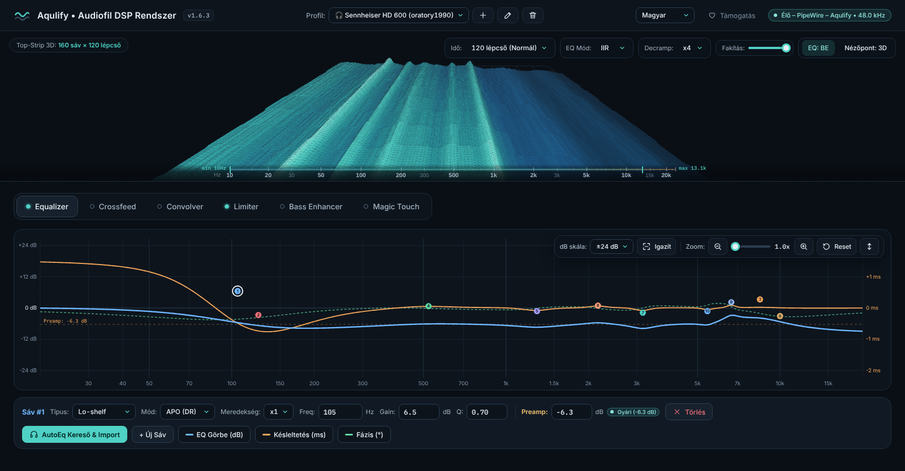

# Aqulify • Real-Time Audio DSP, Analysis & Bit-Perfect Player

[](https://github.com/Szorgos/ee-phase-waterfall-analyzer/releases/latest)
[-0078D6?style=flat-square&logo=windows)](https://github.com/Szorgos/ee-phase-waterfall-analyzer/releases/latest/download/Aqulify-Setup.exe)
[](#-linux--raspberry-pi)
[](#-macos-12-apple-silicon--intel)
[](#-support)
[](LICENSE)

> **Website & English Guide:** [aqulify.pages.dev/en/](https://aqulify.pages.dev/en/) · **Latest Releases:** [GitHub Releases](https://github.com/Szorgos/ee-phase-waterfall-analyzer/releases/latest) · **Magyar leírás:** [README.hu.md](README.hu.md)

**Aqulify** is a free, open-source (GPL-3.0), local desktop DSP suite and music player for **Windows 10/11**, **macOS 12+**, **Linux (PipeWire)**, and **Raspberry Pi 4/5**, with an optional **Android remote** app.

It combines system-wide real-time audio processing (parametric EQ with 8,850 AutoEq headphone profiles, convolution, `libbs2b` crossfeed, True Peak limiter, loudness, and Magic Touch restoration) with a live GPU-accelerated 3D acoustic waterfall, phase/group-delay visualization, and a bit-perfect built-in player supporting PCM up to 768 kHz and DSD up to DSD1024 (native DSD / DoP output on Linux and Windows; on macOS DSD is converted to PCM for now, see [Limitations](#limitations-known-issues--what-it-does-not-do-yet)).

Everything runs locally on your machine. No account, no subscription, no telemetry by default.



---

## Core Features

### 1. Parametric EQ, Phase/Group Delay & AutoEq (8,850 Profiles)
- **LSP Parametric Equalizer:** up to 32 bands, 12 filter types, `RLC` / `BWC` / `LRX` / `APO` filter modes, `x1`–`x4` slopes, and `IIR`, `FIR`, `FFT`, and `SPM` processing modes (linear-phase in `FIR` / `FFT` / `SPM`), plus Decramp oversampling.
- **Live Phase & Group Delay ($-d\phi / d\omega$):** computed in the engine using the exact same filter math that processes the audio.
- **Built-in AutoEq Browser (8,850 entries):** one-click search and import from Jaakko Pasanen's [AutoEq](https://github.com/jaakkopasanen/AutoEq) repository (oratory1990, Crinacle, Rtings, etc.).
- **Manual Import:** file or pasted text in `Filter N: ON PK Fc ... Hz Gain ... dB Q ...` format (AutoEq ParametricEQ, Equalizer APO, REW), including `Preamp:` lines.
- **Automatic Preamp:** adjusts to the peak of the summed EQ curve to avoid clipping (or uses the imported profile's preamp) without double-deduction; bypassed when EQ is off.

### 2. Convolver, Crossfeed, Limiter & DSP Chain
- **Convolver (`zita-convolver` + `SpeexDSP`):** loads WAV and IRS impulse responses with preview, stereo width, autogain, dry/wet, and true-stereo (4-channel matrix) support. IRs are stored per profile.
- **Crossfeed (`libbs2b`):** Bauer bs2b (700 Hz / 4.5 dB), Jan Meier (650 Hz / 9.5 dB), Near-field studio (600 Hz / 3.5 dB), or custom cutoff (300–2000 Hz) and feed level (1–15 dB).
- **True Peak Limiter (LSP):** 12 modes, oversampling (True Peak), lookahead/attack/release, ALR; defaults to `-1.0 dB` threshold, True Peak, 24-bit.
- **Bass Enhancer (Calf), Loudness (ISO 226:2003/2023, Fletcher–Munson, Robinson–Dadson), Stereo Tools, Subsonic Cut & Mono Bass:** each module can be toggled independently with click-free crossfades.
- **Channels & Dither:** per-channel delay (`0–20 ms`), gain (`-24…+6 dB`), polarity inversion, and TPDF or noise-shaped dither (`16` / `24` bit). Dither only runs when DSP modifies the signal; untouched paths remain bit-perfect.
- **Magic Touch:** restrained automatic enhancer (*Natural*, *Warm*, *Bright*, *Spacious*) with optional restoration (50/60 Hz hum removal, click repair, `RNNoise` noise reduction) and loudness-matched A/B comparison.

### 3. Live 3D Acoustic Waterfall
- **Real Engine FFT Spectrum:** 160 bands (`0 Hz – 24 kHz`; ~3 Hz resolution below 75 Hz from a dedicated decimated FFT) at up to 60 fps.
- **GPU-Accelerated WebGL (`three.js`):** offloads rendering from the audio thread; supports 3D isometric, side profile, and top spectrogram views, up/down flow, heatmap fade, and keystone correction. Pauses automatically when minimized/covered.

### 4. Built-in Player, High-Res PCM, DSD & Upsampling
- **Supported Audio File Formats:** `FLAC`, `WAV`, `AIFF` / `AIFF-C` (`.aif`, `.aiff`, `.aifc`), `MP3`, `Ogg Vorbis` (`.ogg`, `.oga`), `ALAC` (`.m4a`, `.alac`, `.caf`), `Opus`, `WavPack` (`.wv`), and `DSD` (`.dsf`, `.dff` from DSD64 to DSD1024; bit-exact native DSD / DoP output on Linux and Windows only, on macOS DSD is converted to PCM).
- **Internet Radio & UPnP / DLNA Renderer:** play custom station streams (`MP3`, `Ogg Vorbis`, `Opus`, `FLAC`, `AAC` / `HE-AAC` / `HE-AACv2` via FAAD2) or cast from UPnP/DLNA controllers through the full DSP chain.
- **Exclusive / Direct Outputs:**
  - **Windows:** `WASAPI Exclusive` and `ASIO` (Steinberg ASIO SDK 2.3.4, GPLv3) for the built-in player; Equalizer APO plugin (`Aqulify.dll`) for system-wide audio.
  - **Linux / Raspberry Pi:** `PipeWire` virtual sink (`Aqulify`) for system-wide audio; direct exclusive `ALSA` (including native DSD `DSD_U32_BE/LE`, `U16_BE/LE`, `U8` or DoP 1.1), follow-the-source sample rate with silent keep-awake pause during playback, and native PipeWire/WirePlumber output, volume, and hardware sample-rate detection (USB and non-USB I2S/onboard DACs, even on headless systems without `pactl`).
  - **macOS:** Core Audio Tap (macOS 14.2+, no virtual driver required) or `BlackHole 2ch` (macOS 12–14.1), plus Core Audio hog/exclusive mode for PCM. DSD plays converted to PCM (DoP is not implemented on macOS yet).
- **Software Upsampling (off by default):** choose between `libsoxr`, `Aqulify FFT64` (64-bit single-stage Kaiser-sinc), and `Aqulify FFT-DD` (106-bit Double-Double, scored **99.85%** Overall Balanced Quality in [HydrogenAudio SRC Comparisons](https://src.hydrogenaudio.org/compareresults?id1=1e745780-027e-4323-9f8d-212c349e715c&id2=0)), with selectable phase (minimum / intermediate / linear) and optional **"All audio"** system-wide upsampling bridge (on Linux, two independent PipeWire clock domains with live output switching and clean direct-mode fallback when the hardware does not support the target rate).

### 5. Experimental Features & Android Remote
- **Room Measurement & Correction (experimental):** 5-step swept-sine wizard with mic calibration (`.cal`, `.txt`, `.frd`, `.csv`), multi-point power averaging, per-channel L/R EQ capped at `+3.0 dB` boost, and automatic preamp.
- **Multiple Outputs & Active Crossover (Linux & macOS):** drive 2–4 DACs simultaneously with independent DSP chains, or split bands with Linkwitz–Riley (12/24/48 dB/oct) crossovers and per-way EQ.
- **Android Remote (`Aqulify-Remote-1.5.4.apk`, Android 8+):** control playback, library, radio, volume, and DSP over local Wi-Fi (QR pairing) or Bluetooth fallback (Windows, Linux, Pi).

---

## Installation

### Windows 10 / 11 (64-bit)
Download and run **[Aqulify-Setup.exe](https://github.com/Szorgos/ee-phase-waterfall-analyzer/releases/latest/download/Aqulify-Setup.exe)** (verify with the `.sha256` file in [Releases](https://github.com/Szorgos/ee-phase-waterfall-analyzer/releases/latest); see [windows/README_WINDOWS.md](windows/README_WINDOWS.md) for details).
- Detects or downloads **Equalizer APO** and inserts `Aqulify.dll` at the end of the chain.
- Runs as a tray application with a standalone WebView2 window.

> **Unsigned Windows Binary Note:** As a solo open-source project without a paid code-signing certificate yet, Windows SmartScreen and browser download warnings will trigger on `Aqulify-Setup.exe` (*More info -> Run anyway*). If **Smart App Control** is enabled in Windows Security, it blocks unsigned binaries including the Equalizer APO plugin. All releases are built transparently via GitHub Actions with `.sha256` checksums.

### macOS 12+ (Apple Silicon & Intel)
Download **[Aqulify-macOS.dmg](https://github.com/Szorgos/ee-phase-waterfall-analyzer/releases/latest/download/Aqulify-macOS.dmg)** and drag **Aqulify** to *Applications*.
- **macOS 14.2+:** uses Core Audio Tap (grant system audio recording permission on first run).
- **macOS 12–14.1:** requires the free [BlackHole 2ch](https://existential.audio/blackhole/) virtual audio device.

> **Notarization Note:** The macOS app is ad-hoc signed (not Apple-notarized). On first launch, right-click -> *Open* (or allow via *System Settings -> Privacy & Security -> Open Anyway* on macOS 15+).

### Linux & Raspberry Pi
**Universal one-line installer (Ubuntu/Debian, Fedora, Arch, openSUSE):**
```bash
mkdir -p ~/Aqulify && cd ~/Aqulify && { curl -fsSL https://github.com/Szorgos/ee-phase-waterfall-analyzer/releases/latest/download/Aqulify-Linux.tar.gz 2>/dev/null || wget -qO- https://github.com/Szorgos/ee-phase-waterfall-analyzer/releases/latest/download/Aqulify-Linux.tar.gz; } | tar -xz --strip-components=1 && bash install.sh
```
**Fedora / RHEL COPR (automatic updates):**
```bash
sudo dnf copr enable nlali/aqulify
sudo dnf install aqulify
```
Ready-made `.rpm`, `_amd64.deb`, Arch `.pkg.tar.zst`, and Raspberry Pi 4/5 64-bit (`arm64 .deb`) packages are also available on the [latest release page](https://github.com/Szorgos/ee-phase-waterfall-analyzer/releases/latest).

**Build from source (Linux):**
```bash
git clone https://github.com/Szorgos/ee-phase-waterfall-analyzer.git
cd ee-phase-waterfall-analyzer
bash install.sh
```

---

## Buffer & Latency Notes

- **Linux (PipeWire) & macOS (Core Audio):** buffer size is selectable (`Auto` or `64–4096` samples) in *Output -> Audio Output (Advanced)*. The **Signal Path** panel reports buffer latency, DSP latency, estimated total latency, CPU load, and overrun count.
- **Windows:** system-wide Equalizer APO latency/buffering is controlled by the Windows audio engine; the built-in player can bypass the Windows mixer via **WASAPI Exclusive** or **ASIO**.
- **Convolver (`zita-convolver`):** processing latency does not grow with impulse response length; power-of-two block sizes add zero extra buffering latency (other block sizes add at most 1 block, plus any group delay inherent in the IR itself).
- **Linear-Phase EQ (`FIR` / `FFT` / `SPM`):** introduces ~0.1 s processing delay when active.

---

## Limitations, Known Issues & "What It Does Not Do Yet"

Honest status as of **v3.0.4**:

- **Windows multi-output:** simultaneous 2–4 DAC outputs and active multi-way crossovers work on Linux and macOS only; Windows support is not implemented yet.
- **Room measurement & correction (experimental):** verified extensively with automated tests and a simulated microphone, **not yet validated in the field with a real physical measurement microphone**.
- **"Filter at DAC rate" upsampling & Raspberry Pi DSD:** the v3.0.0 "filter at DAC rate" mode and real-time `DSD1024 -> PCM` throughput on physical Raspberry Pi hardware have not yet been fully benchmarked on real DACs/hardware.
- **macOS DSD:** on macOS, DSD files always convert to PCM (88.2 / 96 kHz), with the DSP chain applied; native DSD and DoP output are not implemented on macOS yet (DoP is planned; native DSD is not, as Core Audio has no common API for it). Even with DoP, DSD1024 converts to PCM on every platform (its DoP stream is 2.8224 MHz, which no DAC accepts), and DSD512 only passes through if the DAC accepts a 1.4112 MHz stream.
- **DSP sample-rate ceiling (`384 kHz`):** DSP modules process up to `384 kHz`. At `705.6 / 768 kHz`, audio passes through untouched and bit-perfect (shown in the UI).
- **AutoEq / REW manual import:** imports parametric filter lists (`Filter N: ON ...`), and intentionally skips `GraphicEQ` lines and raw CSV frequency-response curves.
- **Linux multi-output clock sync:** outputs 2–4 are independent zones and are not sample-locked (up to ~2 PipeWire quanta offset on Linux).
- **Internet radio streams:** HLS (`hls`) and MP4-container AAC streams are not supported yet.
- **Mobile remote:** Android 8+ only (no iOS app).
- **Code signing:** Windows `.exe` and macOS `.dmg` are not commercially signed/notarized yet.

---

## License & Third-Party DSP

Licensed under **GNU General Public License v3.0 (GPL-3.0)** — see [LICENSE](LICENSE).
- Copyright (C) 2026 **Szorgos** (<https://github.com/Szorgos>)
- DSP libraries (`third_party/README.md`): LSP (LGPL-3.0+), Calf (LGPL-2.1+), libbs2b (MIT), SpeexDSP (BSD-3-Clause), zita-convolver (GPL-3.0+), RNNoise (BSD-3-Clause), FFTW3 (GPL-2.0+), libsoxr (LGPL-2.1+), FAAD2 (GPL-2.0+), Steinberg ASIO SDK 2.3.4 (GPL-3.0 option).
- AutoEq database index & profiles sourced from [jaakkopasanen/AutoEq](https://github.com/jaakkopasanen/AutoEq) (MIT).

---

## Support

Aqulify is free and open-source (**donateware**): every feature is usable without limits. If you find it useful, voluntary support helps fund ongoing development.

<p align="center">
  <a href="https://revolut.me/gergoqhg6"></a><br>
  <b>Revolut: <a href="https://revolut.me/gergoqhg6">@gergoqhg6</a></b>
</p>
